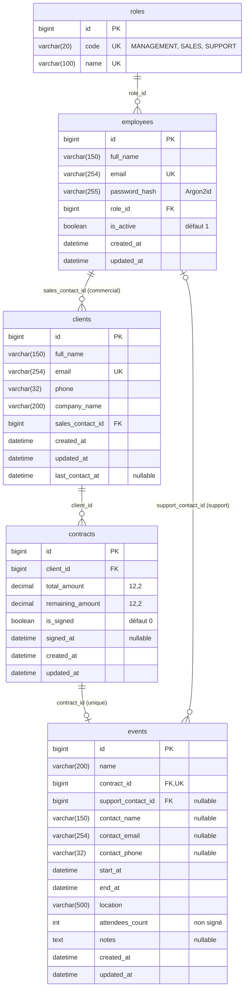

# Schéma de la base de données

Base MySQL `epic_events` (moteur InnoDB, `utf8mb4_0900_ai_ci`), définie par
les modèles SQLAlchemy de [`app/models.py`](../app/models.py).

## Relations

| Relation | Cardinalité | Suppression du parent |
| --- | --- | --- |
| `employees.role_id` → `roles.id` | un rôle, plusieurs collaborateurs | interdite (`RESTRICT`) |
| `clients.sales_contact_id` → `employees.id` | un commercial, plusieurs clients | interdite (`RESTRICT`) |
| `contracts.client_id` → `clients.id` | un client, plusieurs contrats | interdite (`RESTRICT`) |
| `events.contract_id` → `contracts.id` | un contrat, au plus un événement | interdite (`RESTRICT`) |
| `events.support_contact_id` → `employees.id` | un support, plusieurs événements ; facultatif | le champ passe à `NULL` |

## Contraintes de contrôle

| Nom | Règle |
| --- | --- |
| `chk_contracts_amounts` | `0 <= remaining_amount <= total_amount` |
| `chk_contracts_signature` | non signé sans date, ou signé avec `signed_at` renseigné |
| `chk_events_dates` | `end_at > start_at` |
| `chk_events_contact` | `contact_email` ou `contact_phone` renseigné |

Index : `role_id`, `sales_contact_id`, `client_id`, `(is_signed, remaining_amount)`,
`support_contact_id` et `start_at`.
